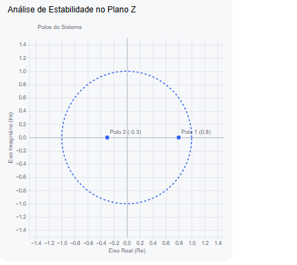

# Função de Transferência
A função de transferência $H(z)$ de um sistema discreto é a razão 
entre a transformada Z da saída $Y(z)$ e a transformada Z da entrada $X(z)$:

$H(z)=$frac{Y(z)}{X(z)}$

# Estabilidade na Transformada Z

Para um sistema linear e invariante no tempo (SLIT) ser estável (no critdério BIBO - Bounded-Input, Bounded-Output), a condição envolve a posição dos polos de $H(z)$ no plano complexo $z$:

• Condição de Estabilidade: Todos os polos em malha fechada do sistema devem estar estritamente dentro do círculo unitário no plano Z.

• Matematicamente, o módulo de cada polo $z_{i}$ deve ser menor que 1:
$|{}z_{i}|{}<1$

Resumo do Comportamento dos Polos

|Posição do Polo ($z$) |Comportamento do Sistema|
| :--- | :---: |
|$$vert{}z$vert{} < 1$ (Dentro do círculo unitário)|Estável (a resposta decai com o tempo)|
|$$vert{}z$vert{} = 1$ (Sobre o círculo unitário)	|Marginalmente estável (oscilações sustentadas)|
|$$vert{}z$vert{} > 1$ (Fora do círculo unitário)|	Instável (a resposta cresce indefinidamente)|

 ## Exemplo de cálculo da função de transferência $H(z)$, calculo dos polos e determinação da estabilidade do sistema.

### Cenário: Sistema de Segunda Ordem

Considere um sistema cuja equação de diferenças que relaciona a entrada $x[n]$ com a saída$y[n]$ seja dada por:

$y[n]-0.5y[n-1]-0.24y[n-2]=x[n]$

Passo 1: Aplicar a Transformada Z

Aplicando a propriedade do deslocamento no tempo $y[n-k] $xrightarrow{$mathcal{Z}} z^{-k}Y(z)$, transformamos a equação para o domínio Z:

$Y(z)-0.5z^{-1}Y(z)-0.24z^{-2}Y(z)=X(z)$

Isolando $Y(z)$ em evidência:

$Y(z)$cdot $left(1-0.5z^{-1}-0.24z^{-2}$right)=X(z)$

A função de transferência

$H(z) = $frac{Y(z)}{X(z)}$ será:

$H(z)=$frac{1}{1-0.5z^{-1}-0.24z^{-2}}$

Multiplicando o numerador e o denominador por$z^{2}$ para trabalhar com potências positivas:

$H(z)=$frac{z^{2}}{z^{2}-0.5z-0.24}$

Passo 2: Encontrar os Polos do Sistema

Os polos são as raízes do polinômio do denominador. Igualamos o denominador a zero:

$z^{2}-0.5z-0.24=0$

Utilizando a fórmula de Bhaskara para resolver a equação quadrática:

$z=$frac{-(-0.5)$pm $sqrt{(-0.5)^{2}-4$cdot 1$cdot (-0.24)}}{2$cdot 1}$s

$z=$frac{0.5$pm $sqrt{0.25+0.96}}{2}=$frac{0.5$pm $sqrt{1.21}}{2}$

$z=$frac{0.5$pm 1.1}{2}$

Isso nos dá dois polos:

•$z_1 = $frac{0.5 + 1.1}{2} = 0.8$

•$z_2 = $frac{0.5 - 1.1}{2} = -0.3$

Passo 3: Análise de Estabilidade

Para o sistema ser estável, o módulo de todos os polos deve ser menor que 1 ($$vert{}z$vert{} < 1$).

•$$vert{}z_1$vert{} = $vert{}0.8$vert{} = 0.8 < 1$

•$$vert{}z_2$vert{} = $vert{}-0.3$vert{} = 0.3 < 1$

Como ambos os polos estão estritamente dentro do círculo unitário no plano complexo Z, o sistema é ESTÁVEL. Se a entrada for limitada, a saída não crescerá até o infinito e qualquer oscilação natural do sistema irá decair até zero com o tempo.

Parte 1: Exemplo com Polos Complexos

Se alterarmos a equação de diferenças para incluir uma oscilação amortecida, podemos ter uma função de transferência com o seguinte denominador:

$D(z)=z^{2}-z+0.5=0$

Aplicando a fórmula de Bhaskara para encontrar as raízes (polos):

$z=\frac{-(-1) \pm \sqrt{(-1)^{2}-4\cdot 1\cdot 0.5}}{2}$

$z=\frac{1 \pm \sqrt{1-2}}{2}=\frac{1 \pm \sqrt{-1}}{2}$

$z_{1,2}=0.5 \pm 0.5j$

Análise de Estabilidade pelo Módulo:

Para saber se é estável, calculamos o módulo do número complexo:

$|z|=\sqrt{(0.5)^{2}+(0.5)^{2}}=\sqrt{0.25+0.25}=\sqrt{0.5}\approx 0.707$

Como $(0.707 < 1$), os polos estão dentro do círculo unitário. O sistema é ESTÁVEL, mas devido à parte imaginária ($j$), a sua resposta no tempo terá oscilações que decaem até zero.

Parte 2: O Critério de Jury (Para ordens maiores)

Foge ao escopo deste material.